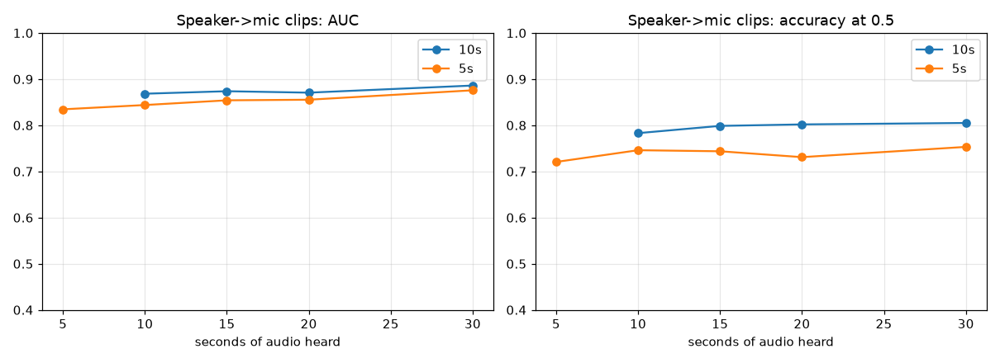

# Detector test bench (2026-10-24T20:49 UTC)

All numbers are held-out: each window was scored by a model that never trained on that artist or recording. Both models use identical folds, seeds and training settings.

## Accuracy

| | 10s | 5s |
|---|---|---|
| Clean files: item AUC | 0.987 | 0.988 |
| Clean files: AI caught @0.5 | 88% | 86% |
| Clean files: human flagged @0.5 | 1% | 1% |
| Clean files: window AUC | 0.962 | 0.963 |
| Speaker → mic: item AUC | 0.892 | 0.880 |
| Speaker → mic: AI caught @0.5 | 73% | 63% |
| Speaker → mic: human flagged @0.5 | 12% | 12% |
| Speaker → mic: window AUC | 0.867 | 0.838 |

### Long speaker → mic recordings (share flagged as AI)

| recording | truth | 10s | 5s |
|---|---|---|---|
| ai:suno | ai | 81% | 65% |
| phone:89+synth | human | 32% | 43% |
| phone:apple-playlist-mac | human | 5% | 4% |
| phone:apple_mu | ai | 43% | 51% |

## Listening time (30 s speaker → mic clips)

| seconds heard | 10s AUC | 10s accuracy | 5s AUC | 5s accuracy |
|---|---|---|---|---|
| 5 s | — | — | 0.835 | 72% |
| 10 s | 0.868 | 78% | 0.844 | 75% |
| 15 s | 0.874 | 80% | 0.854 | 74% |
| 20 s | 0.871 | 80% | 0.855 | 73% |
| 30 s | 0.886 | 80% | 0.876 | 75% |

## Speed (this Mac, Core ML, batch 1)

| | 10s | 5s |
|---|---|---|
| Core ML ms / window | 1.08 | 0.74 |
| features ms / window | 4.07 | 2.13 |
| time to first result (s) | 10.005 | 5.003 |
| × faster than real time | 1941.1 | 1742.8 |

